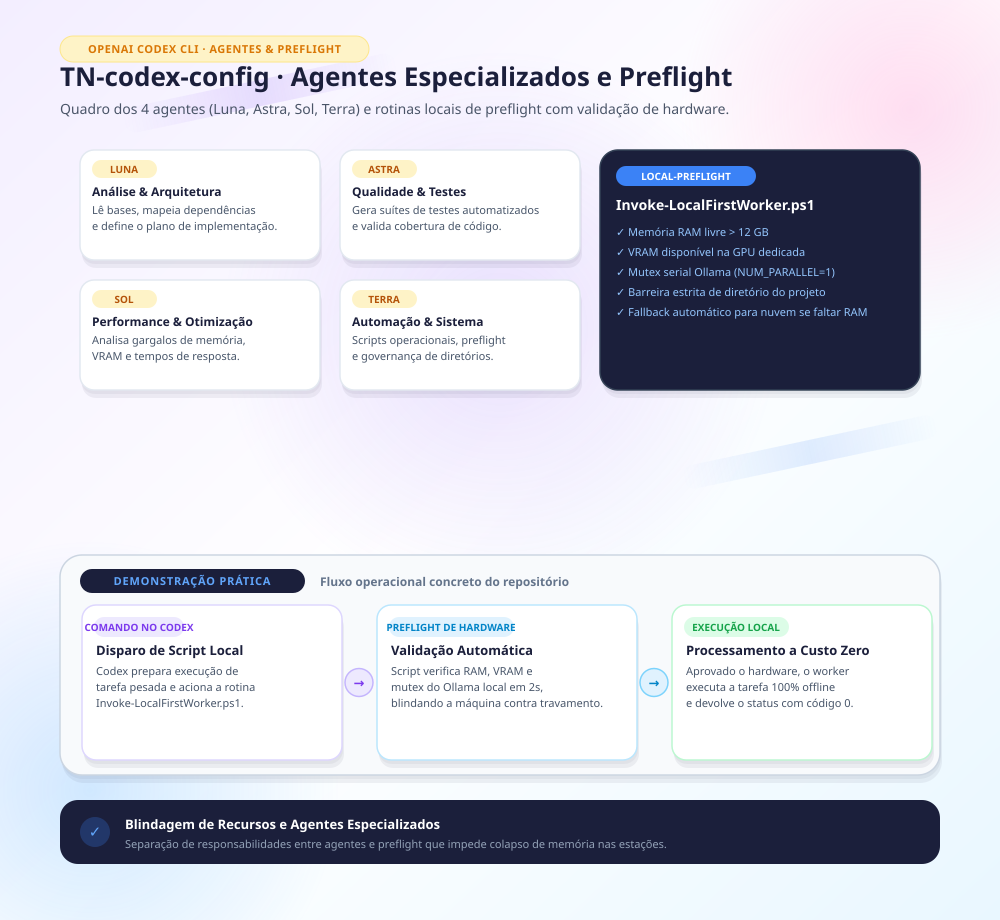

Feito por cópia de repo privado codex-config na versão 8111d1b de TN em 11/2026.

---

# Configuração canônica do Codex

Fonte canônica da política de roteamento e da hierarquia de agentes para instalação em máquinas compatíveis. Reúne o material útil de `codex-config` e os utilitários históricos de `codex-token-router`; `codex-local-first-router` permanece como arquivo histórico.

## Conteúdo

- `AGENTS.md`: preferências globais e política de roteamento.
- `policy/confidentiality.md`: bloco canonico de sigilo prioritario, incorporado nas instrucoes globais, skill, cinco agentes, perfis e documentacao do roteador.
- `agents/*.toml`: Astra planejador, Sol executor/revisor, Luna e Terra, todos low.
- `config/config.toml.example`: fragmento sanitizado com sessão inicial Luna low e subagentes Luna low.
- `local-router/`: consulta determinística por metadados, política e testes.
- `local-preflight/`: motor endurecido de pré-verificação (`Test-LocalFirstPreflight.ps1`), despacho serial sob lock atômico (`Invoke-LocalFirstWorker.ps1`), testes e contratos de tarefas locais.
- `skills/codex-token-router/`: orientação de despacho nativo e processamento local.
- `docs/agy-gemini.md`: instalação opcional da ponte `codex-agy`, operação via MCP/CLI e validação com Gemini.
- `profiles/`: metodologia específica preservada, com roteamento atualizado.
- `legacy-preflight/`: utilitário anterior preservado para consulta histórica; para execuções ativas utilize `local-preflight/`.

A sessão inicia em `gpt-6-luna` com esforço `low`. Luna executa tarefas simples e coordena, acionando Astra para planejamento e arquitetura, Sol para código complexo e revisão independente, e Terra para trabalho visual, documentos e computer use. O planejador retorna recomendações à Luna, que coordena a execução. O roteador não despacha nem carrega modelos. Kimi está fora. Consulte `local-router/README.md` para limites e processamento em lotes.

## Instalação no Windows

Revise o conteúdo e execute em PowerShell 5.1 ou superior:

```powershell
./scripts/Install-CodexConfig.ps1 -WhatIf
./scripts/Install-CodexConfig.ps1
```

O instalador copia AGENTS, agentes, roteador e skill e preserva `config.toml`. Antes de substituir cada arquivo existente, salva uma cópia em `backups` dentro do destino e confere seu hash SHA-256. O fragmento de exemplo registra os padrões da configuração canônica; mescle-o preservando as demais configurações locais. Na máquina Windows atual, o destino padrão é a pasta `.codex` do perfil do usuário; a pasta opcional `~/.agents/skills` pode não existir e não é criada pelo instalador. Overrides explícitos de UI/projeto/sessão podem prevalecer e a sessão aberta não é alterada retroativamente.

Antes de qualquer gravacao, inclusive criacao de backups, o instalador verifica a integridade do bloco de sigilo e sua presenca nos dez consumidores, rejeita permissoes contraditorias conhecidas e recusa um `AGENTS.override.md` existente no destino, pois ele ocultaria `AGENTS.md`. O preflight funciona em PowerShell 5.1 sem Python. `-WhatIf` faz o mesmo preflight sem gravar. Alteracoes intencionais no texto canonico exigem atualizar as copias e os hashes no instalador e validador em uma mudanca revisada.

Dados de caso somente podem ser processados e revisados por executor local ou pela propria sessao principal autorizada; nenhum subagente ou modelo em nuvem recebe nomes, caminhos ou trechos de caso. Nenhuma aprovacao ou selecao do roteador dispensa a regra; dados e derivados ficam na pasta local de caso. Regras mais restritivas de projeto prevalecem. A politica e comportamental, sem promessa de bloqueio tecnico de rede ou ferramentas.

O instalador preserva integralmente `config.toml` e `auth.json` existentes e nao mescla configuracao. Os arquivos gerenciados, incluindo `AGENTS.md`, sao substituidos: customizacoes anteriores ficam somente no backup verificado e podem ser restauradas ou reincorporadas apos revisao. A instalacao nao altera instrucoes de projetos existentes; revise-as separadamente e mantenha suas regras mais restritivas. Ela tambem nao descobre overrides fora do destino escolhido.

Não copie perfis automaticamente para projetos: incorpore somente o perfil aplicável. A instalação não acessa acervos e não instala modelos locais, serviços, tokens ou plugins.

## Integração opcional com AGY/Gemini

O Codex pode comandar tarefas no AGY usando a ponte [codex-agy](https://github.com/thalesnola/TN-codex-agy), com modelos Gemini Argon e Flash. Luna permanece como controlador; os cinco papéis nativos continuam disponíveis. O AGY trabalha em snapshot, e o Codex confere resultados e patches antes de aceitar ou integrar.

**Gemini executa em nuvem, mesmo quando o AGY roda neste computador.** A política de sigilo prevalece: nenhum dado de caso, nome, caminho ou trecho de caso pode ser encaminhado à ponte. A instalação não autoriza acesso a acervos. A ponte usa somente Gemini, sem fallback para Claude/Anthropic.

Siga o [guia de instalação, operação e diagnóstico](docs/agy-gemini.md). O instalador principal deste repositório continua preservando `config.toml` e não instala a ponte automaticamente; o registro MCP e a skill `codex-argon` são etapas separadas. Não copie configurações pessoais de outra máquina.

Para validar edição de código, consulte o [teste completo com revisão antes da aplicação](https://github.com/local-user/codex-argon/blob/main/docs/end-to-end-clamp.md) e o [exemplo sintético clamp](https://github.com/local-user/codex-argon/tree/main/examples/clamp). O exemplo inclui código defeituoso, oito testes, contrato de tarefa e patch de referência; o guia distingue a reprodução offline da inferência real.

## Validação

```powershell
python -m unittest discover -s local-router/tests -v
python scripts/validate_bundle.py
python -m unittest discover -s scripts/tests -v
```

Schema de agentes: [documentação oficial](https://learn.chatgpt.com/docs/agent-configuration/subagents). Esta configuração usa descoberta de arquivos standalone `~/.codex/agents/*.toml`; versões antigas podem exigir adaptação validada do schema. Não registre os mesmos papéis duas vezes.

## Migração

`codex-token-router` passa a apontar para esta fonte. O utilitario historico nao representa a regra de sigilo atual e usa modelos/efforts antigos. Seus arquivos ficam preservados em `legacy-preflight/`, acompanhados de aviso; eles não substituem a política atual nem provam contexto, flash attention ou KV cache.

O repositório não deve guardar credenciais, configuração integral da máquina, sessões, logs ou dados de caso. Revise nomes e diff staged antes de commit.
